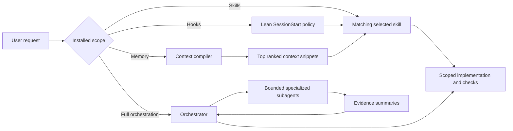
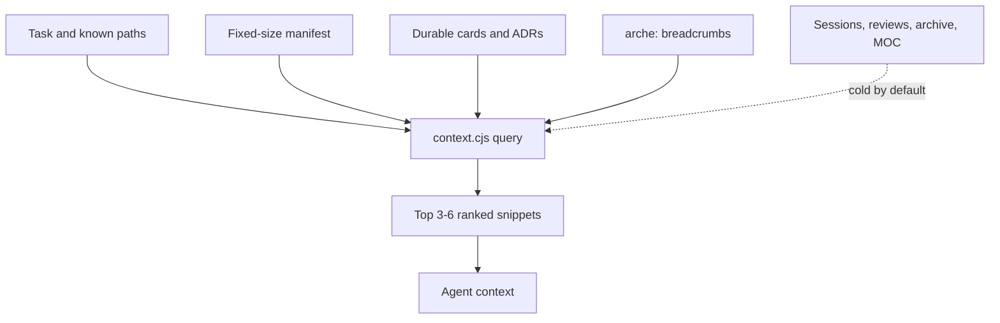

# Agent Arche

A selective Codex engineering harness: install only the skills a project needs, optionally add lean hooks and indexed memory, or opt into explicit multi-agent orchestration.

## Install

```bash
npx agent-arche install
```

The interactive CLI first selects a scope, then presents grouped skills. Backend-only, frontend-only, established, and greenfield projects can therefore install different surfaces.

| Scope | Installs | Runtime posture |
|---|---|---|
| Skills only | Selected `.agents/skills/` and `.codex/agent-arche.json` | Lowest overhead |
| Skills + hooks | Selected skills, config, safety hooks, context compiler | Lean established-project setup |
| Skills + hooks + memory | Above plus indexed durable `memory/` | Recommended |
| Full orchestration | Above plus orchestrator and specialized Codex agents | Highest usage |

> **Usage warning:** Full orchestration costs substantially more usage than a comparable single-agent run. Every subagent performs separate model and tool work. Choose it only when independent workstreams, noisy exploration, tests, or review benefit from delegation.

The installation metadata always lives at `.codex/agent-arche.json`, including Skills-only installs.

### Non-interactive examples

```bash
npx agent-arche --skills-only --select-skills=implement,git --yes
npx agent-arche --skills-hooks --select-skills=implement,design,code-review --yes
npx agent-arche --skills-memory --all-skills --yes
npx agent-arche --orchestration --select-skills=implement,security-review --yes
```

The skill step opens with a scope-aware recommended set checked. Users can deselect any recommendation or select additional frontend, backend, planning, architecture, and delivery skills before installation. `--yes` accepts that scope's recommendations when no explicit selection is supplied.

| Scope | Initially checked |
|---|---|
| Skills only | Core implementation, diagnosis, testing, review, security, Git, and handoff skills |
| Skills + hooks | Same focused core set |
| Skills + hooks + memory | Core set plus `project-startup` for initializing durable project context |
| Full orchestration | Memory defaults plus planning and architecture skills used by complex delegated work |

Framework-specific skills such as `design`, `seo`, and `postgres-patterns` remain opt-in because the installation scope cannot reliably infer a project's technology stack.

Update the files managed by the recorded scope and skill selection with:

```bash
npx agent-arche update
```

Legacy metadata under `.agents/` is still detected; the next update writes canonical metadata under `.codex/`.

## How it works



The harness follows progressive disclosure:

1. Codex sees only installed skill names and descriptions.
2. It loads a skill body only when its trigger matches.
3. The context compiler ranks project evidence deterministically.
4. The model receives at most a small task-specific context pack rather than a full memory map.
5. Full orchestration delegates only tasks that divide cleanly.

## Selectable skills

| Group | Skills |
|---|---|
| Core engineering | `implement`, `diagnosing-bugs`, `tdd`, `code-review`, `karpathy-guidelines` |
| Security and backend | `security-review`, `postgres-patterns` |
| Frontend and growth | `design`, `seo` |
| Planning and architecture | `project-startup`, `to-spec`, `to-tickets`, `grill-with-docs`, `codebase-design`, `improve-codebase-architecture` |
| Delivery and communication | `git`, `handoff`, `caveman` |

`project-startup` is optional. Install it only for a new or unconfigured project. Established projects can omit it entirely.

Full orchestration automatically installs the `orchestrate` routing skill in addition to the user selection.

Every shipped skill includes `agents/openai.yaml` for consistent desktop UI labels and explicit invocation prompts. Codex routing still depends on the concise `name` and `description` in `SKILL.md`; the optional UI metadata is not a replacement for those trigger fields.

## Lean hooks

The hook bundle deliberately contains only:

- `SessionStart`: a short instruction to use matching installed skills and the context compiler.
- `PreToolUse`: a narrow blocklist for catastrophic shell operations.

It does not force Caveman, preload Karpathy, read `_MOC.md`, write memory after every task, or run per-prompt/post-tool instrumentation.

Review and trust project hooks in Codex with `/hooks`.

## Indexed memory



Use:

```bash
node .codex/context/context.cjs index --refresh
node .codex/context/context.cjs query --task "fix session expiry" --paths "src/auth/session.ts"
node .codex/context/context.cjs check
node .codex/context/context.cjs harvest
```

Memory is written only for durable novelty: decisions, cross-cutting constraints, reusable patterns, recurring gotchas, or an explicit unfinished handoff. `_MOC.md` stays fixed-size and exists for humans/Obsidian, not model retrieval.

See [Memory design](docs/MEMORY.md) and [Architecture](docs/ARCHITECTURE.md).

## Full orchestration

Full orchestration installs project-scoped agents under `.codex/agents/`:

- `orchestrator`
- `code_explorer`
- `implementation_worker`
- `reviewer`
- `test_runner`

The orchestrator starts with at most three concurrent subagents, favors parallel read-heavy work, prevents overlapping write ownership, and requires evidence summaries rather than raw logs. Simple tasks remain single-agent.

See [Orchestration](docs/ORCHESTRATION.md).

## Codex files

| Path | Purpose |
|---|---|
| `.agents/skills/` | Only selected skill packages |
| `.codex/agent-arche.json` | Canonical installed scope and skill selection |
| `.codex/config.toml` | Runtime settings for hook-enabled scopes |
| `.codex/hooks.json`, `.codex/hooks/` | Lean lifecycle hooks |
| `.codex/context/` | Deterministic context index/query compiler |
| `.codex/agents/` | Full-orchestration custom agents only |
| `memory/` | Indexed durable project knowledge |

Durable project instructions belong in applicable `AGENTS.md` files. `.codex/instructions.md` is not used as a parallel instruction system.

## Validate

```bash
npm run check
npm run build:dist
npm pack --dry-run
```

## Credits

Agent Arche adapts and combines ideas from several open-source projects. The installed workflows may differ materially from their upstream versions:

- [mattpocock/skills](https://github.com/mattpocock/skills) — engineering workflow and deep-module skill foundations.
- [vercel-labs/skills](https://github.com/vercel-labs/skills) — reference for the redesigned interactive skill-selection CLI experience.
- [DietrichGebert/ponytail](https://github.com/DietrichGebert/ponytail) — inspiration for sparse, machine-searchable source breadcrumbs and deterministic harvesting.
- [cyxzdev/Uncodixfy](https://github.com/cyxzdev/Uncodixfy), [pbakaus/impeccable](https://github.com/pbakaus/impeccable), and [Leonxlnx/taste-skill](https://github.com/Leonxlnx/taste-skill) — design workflow inspiration.
- [JuliusBrussee/caveman](https://github.com/JuliusBrussee/caveman) — explicit compressed communication mode.
- [Akindu23/my-agent-skills](https://github.com/Akindu23/my-agent-skills) — Karpathy-style coding guardrails and PostgreSQL patterns.
- [Clack](https://github.com/bombshell-dev/clack) and [picocolors](https://github.com/alexeyraspopov/picocolors) — CLI prompt and terminal-color libraries.
- [Official OpenAI Codex documentation](https://learn.chatgpt.com/docs/agent-configuration/subagents) — custom-agent configuration and subagent usage boundaries.

See upstream repositories and this package's dependency lockfile for their licenses. Agent Arche itself is MIT licensed.

The component-by-component attribution map is in [NOTICE.md](NOTICE.md).
