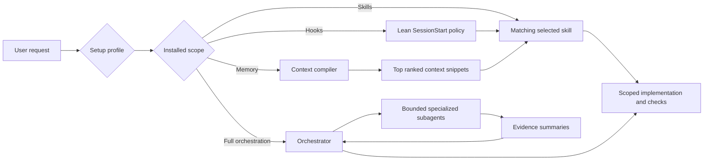
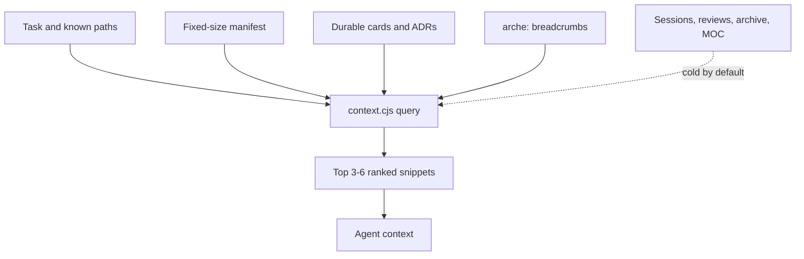

# Agent Arche

A selective engineering harness for **Claude Code** and **Codex**: install only the skills a project needs, optionally add lean hooks and indexed memory, or opt into explicit multi-agent orchestration.

## Install

```bash
npx agent-arche install
```

The interactive CLI first asks which coding agent you use (Claude Code or Codex), then selects a setup profile, an installation scope, project type, and project stage. Those answers determine which grouped skills are initially checked; the user can still select or deselect anything before installation.

| Setup profile | Purpose |
|---|---|
| General Engineering | The existing technology-agnostic engineering harness |
| Commerce Stack | Shopify + Klaviyo + Django skills, integrations, and orchestration specialists |

| Scope | Platform | Installs | Runtime posture |
|---|---|---|---|
| Skills only | Both | Selected skills and install metadata | Lowest overhead |
| Skills + hooks | Both | Selected skills, config, safety hooks, context compiler | Lean established-project setup |
| Skills + hooks + memory | Both | Above plus indexed durable `memory/` | Recommended |
| Usage-optimized subagents | Claude Code | Above plus cheap read-only subagents | Saves main-context tokens on noisy work |
| Full orchestration | Codex | Above plus orchestrator and specialized agents | Highest usage |

> **Usage warning:** Full orchestration costs substantially more usage than a comparable single-agent run. Every subagent performs separate model and tool work. Choose it only when independent workstreams, noisy exploration, tests, or review benefit from delegation.

Claude Code delegates to subagents natively, so it does not get an orchestration layer. Its fourth scope installs only subagents that *reduce* usage: they absorb noisy work (wide searches, long test logs, verbose MCP output) on a cheaper model and return a short summary. Implementation always stays in the main thread.

The installation metadata lives at `.claude/agent-arche.json` or `.codex/agent-arche.json`, including Skills-only installs. A project can have both. **Commerce Stack Skills-only does not install or configure MCP servers.**

### Non-interactive examples

```bash
npx agent-arche --platform=claude --profile=general --skills-memory --project-type=full-stack --project-stage=established --yes
npx agent-arche --platform=claude --profile=commerce --subagents --all-skills --yes
npx agent-arche --platform=codex --profile=general --skills-only --select-skills=implement,git --yes
npx agent-arche --platform=codex --profile=commerce --skills-hooks --project-type=full-stack --project-stage=established --yes
npx agent-arche --platform=codex --profile=general --skills-hooks --select-skills=implement,design,code-review --yes
npx agent-arche --platform=codex --profile=general --orchestration --select-skills=implement,security-review --yes
```

The skill step opens with recommendations computed from the setup profile, installation scope, project type, and project stage. Users can deselect any recommendation or select additional skills before installation. `--yes` accepts the computed recommendations when no explicit skill selection is supplied.

The selector keeps a fixed-height, cursor-following viewport. Use `↑`/`↓` to move, `←`/`→` to collapse or expand groups, `Space` to toggle a skill or group, `Enter` to confirm, and `Esc` to cancel.

| Input | Recommendation effect |
|---|---|
| Every project | Core implementation, diagnosis, testing, review, security, Git, and handoff skills |
| Commerce Stack | Adds Klaviyo operations and recommendation workflows, Django commerce integration, end-to-end debugging, and selected official Shopify skills |
| Full-stack | Adds frontend design, SEO, and PostgreSQL workflows |
| Backend | Adds PostgreSQL workflows; leaves frontend skills unchecked |
| Frontend | Adds design and SEO workflows; leaves backend-specific skills unchecked |
| General / other | Keeps only the applicable core set |
| Greenfield | Adds `project-startup` |
| Established | Leaves `project-startup` unchecked |
| Full orchestration (Codex) | Adds planning and architecture workflows used by delegated work |

These are checkbox defaults, not locked bundles. Use `--profile`, `--project-type`, and `--project-stage` for non-interactive selection, or `--select-skills` to override recommendations with an exact set.

Update the files managed by the recorded scope and skill selection with:

```bash
npx agent-arche update
npx agent-arche update --platform=claude   # when both platforms are installed
```

Legacy metadata under `.agents/` is still detected; the next update writes canonical metadata under `.codex/`.

## Claude Code

Claude Code installs share the same skills, memory, and context compiler as Codex, tuned for Claude's runtime and a small context footprint.

| Path | Purpose |
|---|---|
| `.claude/skills/` | Only selected skill packages |
| `.claude/agent-arche.json` | Installed profile, scope, and skill selection |
| `.claude/settings.json` | Hooks, context and output limits (merged into an existing file) |
| `.claude/hooks/` | Lean `SessionStart` and `PreToolUse` scripts |
| `.claude/context/` | Deterministic context index/query compiler |
| `.claude/agents/` | Usage-optimized subagents scope only |
| `.mcp.json` | Commerce Stack MCP servers (merged into an existing file) |
| `memory/` | Indexed durable project knowledge |

Token and context controls:

- **CLAUDE.md, generated on first install.** Claude Code installs use `CLAUDE.md` as the project instruction file, not `AGENTS.md`. On the first install into a project without a `CLAUDE.md`, the installer runs Claude Code headless on Sonnet to write one, a short `/init` that is told to stay under 60 lines because the file loads every session. It may only read the project and write `CLAUDE.md`, and it carries over durable rules from an existing `AGENTS.md`. It asks first (`--yes` accepts). Skip it with `--no-init`, and it falls back to a "Run /init" next step when the `claude` CLI is not on PATH. An existing `CLAUDE.md` is never touched.
- **Rewritten at install time.** Skills are authored once. A Claude install rewrites `.codex/…` paths and `AGENTS.md` references to `CLAUDE.md`, and leaves out Codex-only `agents/openai.yaml` metadata.
- **User-invoked skills stay out of routing context.** `caveman`, `handoff`, `project-startup`, `grill-with-docs`, and `improve-codebase-architecture` set `disable-model-invocation`. Their descriptions never enter the model's context; run them with `/<name>`.
- **Conditional SessionStart.** The hook emits only lines that apply to the checkout (for example, the memory rules only when memory is installed), so it adds roughly 100 tokens. It never repeats `CLAUDE.md`, which Claude Code already loads.
- **Absolute compaction point and smaller tool output.** Current Claude models have a 1M-token window, so a percentage threshold would still let a session grow to hundreds of thousands of tokens. `CLAUDE_CODE_AUTO_COMPACT_WINDOW=250000` compacts at a fixed 250k tokens on any model. That leaves room for large repositories while keeping late-session turns far cheaper than letting a 1M-window session grow toward its limit. On 200k-window models the model's own limit applies first. `BASH_MAX_OUTPUT_LENGTH` and `MAX_MCP_OUTPUT_TOKENS` limit how much a single command or MCP result can return.
- **Usage-optimized subagents** (fourth scope only). All are read-only and return summaries, never raw output. Their descriptions tell Claude to delegate only when that saves main-context tokens, not for a lookup that takes a few tool calls.

  | Subagent | Model | Absorbs |
  |---|---|---|
  | `code-explorer` | Haiku | Searches and reads across many files |
  | `test-runner` | Haiku | Long test, build, lint, and typecheck logs |
  | `reviewer` | Sonnet | Independent review of a large diff |
  | `klaviyo-specialist` (Commerce) | Sonnet | Verbose Klaviyo MCP investigations |
  | `shopify-specialist` (Commerce) | Sonnet | Verbose Shopify Dev MCP schema and doc lookups |
- **Secrets stay out of context.** Reads of `.env`, `.env.local`, `.env.*.local`, and `.env.production` are denied.

The installer merges `settings.json` and `.mcp.json` instead of replacing them: your keys stay, and Agent Arche hooks are updated in place on reinstall. The general profile installs no MCP servers. Commerce Stack adds Klaviyo (read-only, core tools), Shopify Dev MCP, and Context7 to `.mcp.json`; approve them and sign in to Klaviyo with `/mcp`. On native Windows, if a stdio server fails to start, change its `command` to `cmd` with args `["/c", "npx", ...]`.

## How it works



The harness follows progressive disclosure:

1. Codex sees only installed skill names and descriptions.
2. It loads a skill body only when its trigger matches.
3. The context compiler ranks project evidence deterministically.
4. The model receives at most a small task-specific context pack rather than a full memory map.
5. Full orchestration delegates only tasks that divide cleanly.

## Selectable skills

| Group | Skills |
|---|---|
| Core engineering | `implement`, `diagnosing-bugs`, `tdd`, `code-review`, `karpathy-guidelines` |
| Security and backend | `security-review`, `postgres-patterns` |
| Frontend and growth | `design`, `seo` |
| Planning and architecture | `project-startup`, `to-spec`, `to-tickets`, `grill-with-docs`, `codebase-design`, `improve-codebase-architecture` |
| Delivery and communication | `git`, `handoff`, `caveman` |
| Klaviyo and commerce operations (Commerce Stack) | `klaviyo-operations`, `klaviyo-product-recommendations`, `klaviyo-customer-agent`, `commerce-integration-debugging`, `django-commerce-backend` |
| Shopify AI Toolkit, official (Commerce Stack) | `shopify-admin`, `shopify-liquid`, `shopify-custom-data`, `shopify-use-shopify-cli`, `shopify-dev` |

`project-startup` is optional. Install it only for a new or unconfigured project. Established projects can omit it entirely.

Full orchestration automatically installs the `orchestrate` routing skill in addition to the user selection.

Every Agent Arche-authored skill includes `agents/openai.yaml` for consistent desktop UI labels and explicit invocation prompts. The vendored official Shopify skills retain their upstream package structure. Codex routing still depends on the concise `name` and `description` in `SKILL.md`; optional UI metadata is not a replacement for those trigger fields.

The official Shopify skill scripts disclose usage telemetry to Shopify. Set `OPT_OUT_INSTRUMENTATION=true` to opt out. See [Commerce Stack](docs/COMMERCE_STACK.md) and [NOTICE](NOTICE.md) for sources and the vendored snapshot.

## Commerce Stack MCPs

The three Commerce Stack scopes that include `.codex/config.toml` configure:

- Klaviyo's official remote MCP at `https://mcp.klaviyo.com/mcp`, read-only by default and requiring OAuth login;
- Shopify's official `@shopify/dev-mcp` for current developer docs, schemas, and validation;
- Context7 for current Django documentation lookup.

Django does not currently publish an official MCP server. Agent Arche does not install a community package that exposes a project's models, admin, or API automatically. That requires a separate project-specific security decision.

## Lean hooks

The hook bundle deliberately contains only:

- `SessionStart`: a short instruction to use matching installed skills and the context compiler.
- `PreToolUse`: a narrow blocklist for catastrophic shell operations.

It does not force Caveman, preload Karpathy, read `_MOC.md`, write memory after every task, or run per-prompt/post-tool instrumentation.

Review and trust project hooks with `/hooks` (both Codex and Claude Code). The Claude Code `PreToolUse` hook also covers the PowerShell tool.

## Indexed memory



Use:

```bash
node .codex/context/context.cjs index --refresh
node .codex/context/context.cjs query --task "fix session expiry" --paths "src/auth/session.ts"
node .codex/context/context.cjs check
node .codex/context/context.cjs harvest
```

Memory is written only for durable novelty: decisions, cross-cutting constraints, reusable patterns, recurring gotchas, or an explicit unfinished handoff. `_MOC.md` stays fixed-size and exists for humans/Obsidian, not model retrieval.

See [Memory design](docs/MEMORY.md) and [Architecture](docs/ARCHITECTURE.md).

## Full orchestration (Codex)

Full orchestration installs project-scoped agents under `.codex/agents/`:

- `orchestrator`
- `code_explorer`
- `implementation_worker`
- `reviewer`
- `test_runner`

Commerce Stack also installs:

- `klaviyo_specialist`
- `shopify_specialist`
- `django_integration_specialist`

The orchestrator starts with at most three concurrent subagents, favors parallel read-heavy work, prevents overlapping write ownership, and requires evidence summaries rather than raw logs. Simple tasks remain single-agent.

See [Orchestration](docs/ORCHESTRATION.md).

## Codex files

| Path | Purpose |
|---|---|
| `.agents/skills/` | Only selected skill packages |
| `.codex/agent-arche.json` | Canonical installed profile, scope, and skill selection |
| `.codex/config.toml` | Runtime settings for hook-enabled scopes |
| `.codex/hooks.json`, `.codex/hooks/` | Lean lifecycle hooks |
| `.codex/context/` | Deterministic context index/query compiler |
| `.codex/agents/` | Full-orchestration custom agents only |
| `memory/` | Indexed durable project knowledge |

Durable project instructions belong in applicable `AGENTS.md` files. `.codex/instructions.md` is not used as a parallel instruction system.

## Repository layout

```text
skills/            shared skill packages (one source for both platforms)
memory/            shared memory vault template
context/           shared deterministic context compiler
claude/            Claude Code: settings.json, hooks/, agents/ (usage-optimized subagents)
codex/             Codex: config.toml, hooks.json, hooks/
  orchestration/   Codex full orchestration: config.toml, agents/, skills/orchestrate/
commerce/          Commerce Stack overlays
  claude/          mcp.json, agents/
  codex/           config.toml, orchestration/ (config.toml, agents/)
bin/               installer CLI
docs/              design documentation
```

Platform-neutral content lives at the root. Anything that only one agent understands lives under `claude/` or `codex/`, and profile overlays mirror that split under `commerce/<platform>/`.

## Validate

```bash
npm run check
npm run build:dist
npm pack --dry-run
```

## Credits

Agent Arche adapts and combines ideas from several open-source projects. The installed workflows may differ materially from their upstream versions:

- [mattpocock/skills](https://github.com/mattpocock/skills) — engineering workflow and deep-module skill foundations.
- [vercel-labs/skills](https://github.com/vercel-labs/skills) — reference for the redesigned interactive skill-selection CLI experience.
- [DietrichGebert/ponytail](https://github.com/DietrichGebert/ponytail) — inspiration for sparse, machine-searchable source breadcrumbs and deterministic harvesting.
- [cyxzdev/Uncodixfy](https://github.com/cyxzdev/Uncodixfy), [pbakaus/impeccable](https://github.com/pbakaus/impeccable), and [Leonxlnx/taste-skill](https://github.com/Leonxlnx/taste-skill) — design workflow inspiration.
- [JuliusBrussee/caveman](https://github.com/JuliusBrussee/caveman) — explicit compressed communication mode.
- [Akindu23/my-agent-skills](https://github.com/Akindu23/my-agent-skills) — Karpathy-style coding guardrails and PostgreSQL patterns.
- [Clack](https://github.com/bombshell-dev/clack) and [picocolors](https://github.com/alexeyraspopov/picocolors) — CLI prompt and terminal-color libraries.
- [Official OpenAI Codex documentation](https://learn.chatgpt.com/docs/agent-configuration/subagents) — custom-agent configuration and subagent usage boundaries.
- [Shopify AI Toolkit](https://github.com/Shopify/shopify-ai-toolkit) — official vendored Shopify skills and Dev MCP configuration.

See upstream repositories and this package's dependency lockfile for their licenses. Agent Arche itself is MIT licensed.

The component-by-component attribution map is in [NOTICE.md](NOTICE.md).
