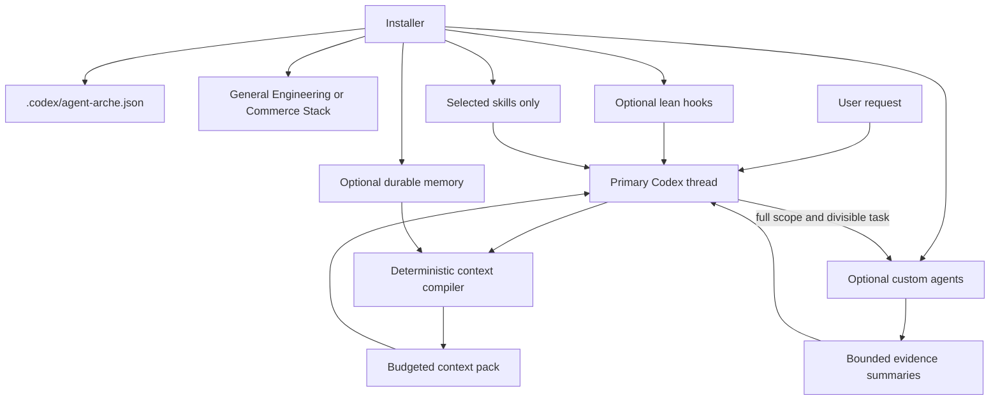

# Architecture

Agent Arche separates deterministic context preparation from model judgment.



## Design boundaries

- Installation is selective. Uninstalled skill descriptions cannot consume routing context.
- SessionStart remains fixed-size and does not preload skill bodies.
- Context filtering, ranking, aggregation, and breadcrumb harvesting happen in Node before model input.
- Model judgment handles interpretation, implementation, review, and final synthesis.
- Memory history grows on disk without growing startup context.
- Multi-agent work is opt-in, capped, and used only for independent or context-noisy work.

## Scope composition

```text
skills
  selected skills + canonical metadata

skills-hooks
  skills + config + SessionStart + PreToolUse + context compiler

skills-memory
  skills-hooks + durable memory vault

subagents (Claude Code only)
  skills-memory + read-only usage-optimized subagents

orchestration (Codex only)
  skills-memory + orchestrate skill + project-scoped custom agents
```

Codex metadata uses `.codex/agent-arche.json`, and skills remain in `.agents/skills/`, the Codex-compatible shared skill location.

Claude Code installs under `.claude/`: `settings.json` replaces `config.toml` and `hooks.json`, and Commerce MCP servers go to `.mcp.json`. Skills come from the same source and are rewritten at install time (paths, `AGENTS.md` references, `disable-model-invocation` for explicit-only workflows). Claude delegates to subagents natively, so instead of an orchestrator it gets read-only subagents on cheaper models. They exist to keep noisy output out of the main context, not to parallelize implementation.

## Skill selection profiles

The installer combines four inputs into checkbox defaults:

```text
setup profile + installation scope + project type + project stage -> recommended skills
```

- Every scope starts with the focused engineering core.
- Commerce Stack adds its Klaviyo, Shopify, Django, and cross-system workflows.
- Full orchestration also checks planning and architecture skills used by complex delegated work.
- Project type selects the relevant frontend/backend domain workflows.
- Project stage adds `project-startup` only for greenfield projects.
- The user can still select or deselect every recommendation before installation.

Every checkbox remains editable. Explicit `--select-skills` input replaces the recommendations for the selected setup profile, while `--yes` accepts them. Full orchestration adds its non-selectable `orchestrate` routing skill after selection.

Agent Arche-authored skills include `agents/openai.yaml` for UI presentation. That optional file stays short and does not replace the `SKILL.md` name and description used for progressive-disclosure routing. Vendored official skills retain their upstream structure.

## Context budgets

The compiler defaults to an estimated 1,200-token retrieval budget, at most six results, and a maximum configurable budget of 8,000 tokens. Ranking favors exact task phrases, file/path matches, titles, metadata, and explicit path hints. The agent may read primary source after retrieval when the task requires deeper evidence.

The compiler is a retrieval aid, not a truth oracle. Source code, tests, current configuration, and live behavior remain authoritative.

## Token and quality controls

- Only installed skill names, descriptions, and paths enter initial skill discovery.
- Skill bodies stay below 500 lines; longer detail is routed into conditional references.
- Long references expose an early contents map so the agent can load the right section.
- Deterministic indexing, ranking, filtering, and reduction run outside model context.
- Session history, reviews, archives, and `_MOC.md` remain cold by default.
- Full orchestration is explicit, capped, and reserved for work that divides cleanly.

These controls follow the [official skill progressive-disclosure guidance](https://learn.chatgpt.com/docs/build-skills), [Codex subagent guidance](https://learn.chatgpt.com/docs/agent-configuration/subagents), and [OpenAI lean-prompt guidance](https://developers.openai.com/api/docs/guides/latest-model).
