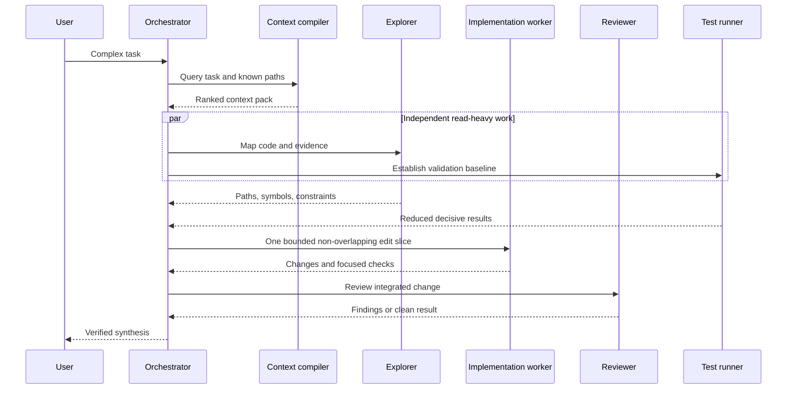

# Full orchestration

Full orchestration is a Codex-only, high-usage option for complex work that benefits from specialized, isolated agent threads.

> Claude Code installs use the lighter **usage-optimized subagents** scope instead; see the README.

> Every subagent performs separate model and tool work. This normally consumes more tokens than a comparable single-agent run.

## Routing

## Delegation gate

Use subagents when:

- Two or more bounded workstreams can proceed independently.
- Exploration, test logs, or review evidence would pollute the primary thread.
- Specialized review materially improves quality.
- Parallelism provides useful wall-clock savings.

Stay single-agent when:

- The task is small or tightly sequential.
- Agents would edit overlapping files.
- One tool call or short investigation is enough.
- Coordination would cost more than the work.

## Controls

- Maximum initial concurrency: three subagents.
- Parallelize read-heavy work first.
- One writer owns each overlapping path set.
- Subagent prompts contain only bounded objective, selected context, ownership, constraints, evidence, and stop condition.
- Subagents return summaries and decisive evidence, not raw logs.
- The orchestrator performs integration validation and never presents unverified worker claims as confirmed.

The custom agents inherit the parent session's live approval and sandbox controls unless an agent definition intentionally narrows them.
